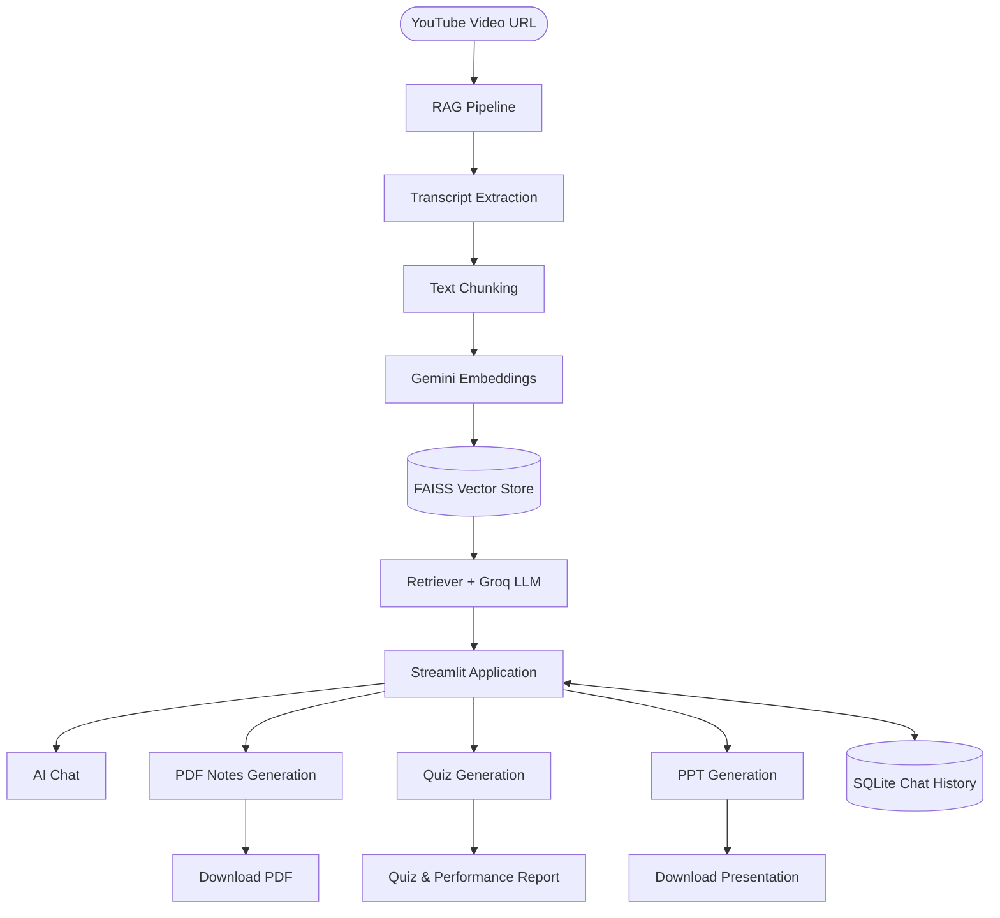

# 🎓 YT-RAG-Assist
### AI-Powered YouTube Video Learning & Assessment Platform

**YT-RAG-Assist** is an AI-powered video learning platform that transforms YouTube videos into interactive learning experiences. It allows students to understand video content through context-aware AI conversations, generate structured study notes, explore visual representations, download professionally formatted PDF notes, and evaluate their understanding through AI-generated quizzes.

Instead of passively watching lengthy educational videos, learners can actively interact with the content, clarify difficult concepts, explore new examples, and test their knowledge in one place.

---

## ✨ Key Features

### 1. 🎥 YouTube Video Processing
- Process educational content directly from YouTube URLs.
- Extract available English and Hindi transcripts.
- Divide transcripts into smaller, searchable text chunks.
- Generate semantic embeddings for contextual retrieval.
- Build a FAISS vector database for efficient similarity-based search.
- Support transcript-based learning without manually uploading notes.

### 2. 💬 AI-Powered Video Chat (RAG)
- Ask questions related to the processed YouTube video.
- Receive context-aware answers using Retrieval-Augmented Generation (RAG).
- Retrieve relevant transcript information before generating responses.
- Maintain conversation context for follow-up questions.
- Get explanations in three supported languages:
  - English
  - Hindi
  - Hinglish
- Distinguish video-based information from supplementary knowledge.
- Reduce unsupported claims through source-grounded prompting.

### 3. 🧠 Intelligent Teaching & Explanation
YT-RAG-Assist is designed to work as an interactive AI tutor rather than a simple question-answering chatbot.

It supports:
- Step-by-step explanations of difficult concepts.
- Simple definitions of technical terminology.
- Fresh illustrative examples when requested.
- Numerical problems with step-by-step calculations.
- Practical applications and real-world analogies.
- Comparison tables and structured explanations.
- Concept-based visual representations.
- Additional knowledge beyond the video when appropriate.

### 4. 📝 AI-Generated Study Notes
- Generate structured study notes from the complete video transcript.
- Process lengthy transcripts through manageable summarization batches.
- Organize content using headings and subheadings.
- Highlight important definitions, concepts, and explanations.
- Include relevant formulas and worked examples.
- Generate notes in English, Hindi, or Hinglish.
- Extract a meaningful document title from the generated content.

### 5. 📊 Visual Learning & Diagram Generation
- Generate concept-based visual representations.
- Support architecture diagrams, process diagrams, and concept maps.
- Create diagrams using structured specifications.
- Generate relevant video visual references through frame extraction and AI-based analysis.
- Associate visual content with relevant study-note sections.
- Use diagrams to make complex concepts easier to understand.

### 6. 📄 Professional PDF Study Notes
Convert generated study notes into downloadable PDF documents.

PDF features include:
- Notebook-inspired document styling.
- Structured headings and subheadings.
- Highlighted important concepts.
- Special formatting for mathematical formulas.
- Highlighted chemical reactions where applicable.
- Tables, code blocks, and educational callout sections.
- Integrated concept diagrams and visual references.
- English and Hindi font support.
- A4 document layout with page numbering.

### 7. 📝 AI-Powered Quiz Generator

Generate interactive quizzes based on the processed video content and study material.

**Six supported question types:**

| Question Type | Description |
|---|---|
| Multiple Choice (MCQ) | Select one correct answer |
| True / False | Identify whether a statement is correct |
| Assertion–Reason | Evaluate statements and their logical relationship |
| Multiple Select | Select all applicable answers |
| Fill in the Blank | Complete missing information |
| Scenario-Based | Apply concepts to practical situations |

**Quiz generation capabilities:**
- AI-generated questions based on video content.
- Structured question generation using JSON.
- Question validation and duplicate detection.
- Batch-based question generation.
- Retry mechanisms for invalid generated questions.
- Support for previous-question exclusion.
- Answer evaluation with explanations and supporting evidence.

### 8. 📈 Quiz Evaluation & Performance Analysis
Evaluate quiz attempts and understand learning progress.

The evaluation system provides:
- Total score and percentage.
- Correct, incorrect, and unanswered questions.
- Question-wise answer evaluation.
- Explanations for answers.
- Topic-wise performance analysis.
- Identification of strong and weak topics.
- Personalized revision suggestions.
- Time-based quiz performance information.

### 9. 💾 Persistent Chat History
- Create multiple conversations.
- Save user questions and AI responses.
- Automatically maintain conversation timestamps.
- Reopen previous conversations.
- Rename conversations.
- Delete unwanted conversations.
- Restore the associated YouTube video context.

SQLite is used to store conversation and message information locally.

---

## 🏗️ System Architecture

The application follows a Retrieval-Augmented Generation architecture combined with AI-powered content generation and assessment modules.

## System Architecture




## 🛠️ Technology Stack

| Category | Technologies |
|---|---|
| Programming Language | Python 3.11+ |
| Frontend | Streamlit |
| LLM Integration | Groq |
| Language Model | `openai/gpt-oss-120b` |
| Embedding Model | Google Gemini `gemini-embedding-001` |
| Vision Model | Google Gemini `gemini-2.5-flash` |
| LLM Framework | LangChain |
| RAG Architecture | Retrieval-Augmented Generation |
| Vector Database | FAISS |
| Transcript Extraction | YouTube Transcript API / LangChain YouTube Loader |
| PDF Generation | Playwright, HTML, CSS |
| PDF Formatting | Markdown, Bleach |
| Image Processing | Pillow |
| Database | SQLite |
| Environment Management | Python dotenv |
| Version Control | Git and GitHub |

---

## 📂 Project Structure

```text
YT-ASSIST/
│
├── data/
│   └── chat_history.db
│
├── fonts/
│   ├── NotoSans-Regular.ttf
│   ├── NotoSans-Bold.ttf
│   ├── NotoSansDevanagari-Regular.ttf
│   └── NotoSansDevanagari-Bold.ttf
│
├── services/
│   └── chat_history_service.py
│
├── yt/
│   └── YouTube-related resources
│
├── streamlit/
│   └── Streamlit-related resources
│
├── app.py
├── streamlit_app.py
├── quiz_generation.py
├── pdf_generator.py
├── main.py
│
├── requirements.txt
├── pyproject.toml
├── .gitignore
└── README.md
```

### Important Files

| File | Responsibility |
|---|---|
| `app.py` | Core application logic, transcript processing, RAG pipeline, AI responses, study material and quiz generation |
| `streamlit_app.py` | Main Streamlit interface, chat management, notes, PDF downloads and interactive quizzes |
| `quiz_generation.py` | Quiz creation, question validation, answer evaluation and performance reporting |
| `pdf_generator.py` | HTML document generation, formatting and PDF rendering |
| `services/chat_history_service.py` | SQLite database operations for conversations and messages |
| `requirements.txt` | Python package dependencies |
| `pyproject.toml` | Project metadata and dependency configuration |

---

## ⚙️ Installation & Setup

Follow these steps to run YT-RAG-Assist locally.

### 1. Clone the Repository

```bash
git clone https://github.com/Nk2603/YT-ASSIST.git
```

### 2. Navigate to the Project Directory

```bash
cd YT-ASSIST
```

### 3. Create a Virtual Environment

Python 3.11 or later is recommended.

**Windows:**

```bash
python -m venv venv
```

Activate the environment:

```bash
venv\Scripts\activate
```

**Linux / macOS:**

```bash
python3 -m venv venv
source venv/bin/activate
```

### 4. Install Dependencies

```bash
pip install -r requirements.txt
```

Install the additional packages required by the current application modules:

```bash
pip install langchain-text-splitters playwright markdown bleach
```

Install the Chromium browser required by Playwright:

```bash
playwright install chromium
```

### 5. Configure Environment Variables

Create a `.env` file in the root directory.

Add your API credentials:

```env
GROQ_API_KEY=your_groq_api_key
GOOGLE_API_KEY=your_google_api_key
```

**API requirements:**

- **Groq API:** Used for language-model-powered responses and content generation.
- **Google AI API:** Used for Gemini embeddings and video-frame analysis.

Keep your API credentials private. Never commit your `.env` file to GitHub.

### 6. Run the Application

Start the Streamlit application:

```bash
streamlit run streamlit_app.py
```

The application will be available at:

```text
http://localhost:8501
```

---

## 🔄 Application Workflow

The overall learning workflow consists of the following stages:

**Step 1: Process a Video**

Enter a valid YouTube video URL. The application extracts the available transcript.

**Step 2: Build the Knowledge Base**

The transcript is divided into chunks, converted into embeddings, and stored in a FAISS vector database.

**Step 3: Interact with the AI Tutor**

Ask questions about the video. The RAG pipeline retrieves relevant transcript sections and generates contextual explanations.

**Step 4: Generate Study Material**

Generate structured study notes and relevant visual representations from the video content.

**Step 5: Download PDF Notes**

Convert the generated study material into a formatted PDF document.

**Step 6: Test Your Knowledge**

Generate a quiz, answer the questions, and submit your attempt.

**Step 7: Analyze Performance**

Review your score, topic-wise performance, mistakes, and revision recommendations.

---

## 🔐 Environment Variables

| Variable | Purpose |
|---|---|
| `GROQ_API_KEY` | Authentication for Groq language models |
| `GOOGLE_API_KEY` | Authentication for Google Gemini services |

Both API keys must be configured before using the corresponding AI functionality.

---

## ⚠️ Requirements & Limitations

- Python 3.11 or later is recommended.
- A valid YouTube URL is required.
- Video transcript availability depends on YouTube captions.
- English and Hindi transcripts are supported by the current transcript loader.
- AI functionality requires valid API credentials.
- API rate limits and usage quotas may affect processing.
- Internet access is required for external AI services and online resources.
- Video-frame extraction depends on video accessibility and successful processing.
- PDF rendering requires Playwright and its Chromium browser.
- Generated AI content should be reviewed for accuracy before academic use.

---

## 🚀 Future Enhancements

Potential improvements for future versions include:

- Support for additional transcript languages.
- More advanced multimodal video understanding.
- Improved long-video processing and retrieval.
- Timestamp-linked answers and explanations.
- Advanced personalized learning recommendations.
- More interactive visual learning components.
- Enhanced quiz analytics and learning progress tracking.
- Cloud-based storage and deployment.
- Improved retrieval evaluation and answer-grounding mechanisms.

---

## 🎯 Project Objective

The primary objective of YT-RAG-Assist is to make online video-based education more interactive, structured, and effective.

By combining Retrieval-Augmented Generation, large language models, semantic search, visual learning, automated study-material generation, and intelligent assessment, the platform provides a unified environment for learning from YouTube educational content.

**Watch. Understand. Explore. Practise. Learn.**

---

## 👩‍💻 Author

**Nisha Kumari**

GitHub: [@Nk2603](https://github.com/Nk2603)

Project Repository: [YT-ASSIST](https://github.com/Nk2603/YT-ASSIST)

---

## ⭐ Support

If you find this project useful or interesting, consider giving the repository a star on GitHub.

Contributions, suggestions, and feedback are welcome.

**Made with Python, LangChain, Groq, Google Gemini, FAISS, and Streamlit.**
