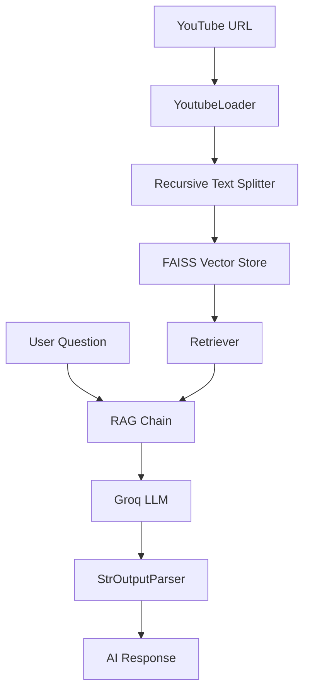

# 🎥 YouTube RAG Assistant

A Retrevial-Augmented Generation (RAG) application that allows users to chat with any YouTube video. The application fetches the video transcript, processes it into chunks, and uses vector search to provide accurate answers based ONLY on the video content.

---

## 🛠 Features

- **Dynamic Video Analysis**: Simply paste a YouTube URL to analyze a new video.
- **AI-Powered Chat**: Ask questions and get answers directly from the video's transcript.
- **Context-Aware Responses**: The AI is strictly instructed to use only the provided video context.
- **State Management**: Automatic reset of chat history and context when a new video is processed.
- **Modern UI**: Clean and interactive chat interface built with Streamlit.

---

## 🏗 Project Structure

```text
LAngchain-Rag-Project/
├── app.py              # Core RAG logic, modularized for reuse.
├── streamlit_app.py    # Streamlit frontend and UI state management.
├── .env                # Environment variables (API Keys).
├── .gitignore          # Files ignored by Git.
├── requirements.txt    # Project dependencies.
└── README.md           # Project documentation.
```

### Key Components

- **`app.py`**: Contains the `initialize_rag_chain()` function which handles:
    - **Loading**: `YoutubeLoader` from LangChain fetches the transcript.
    - **Splitting**: `RecursiveCharacterTextSplitter` breaks the text into manageable chunks.
    - **Embedding**: `GoogleGenerativeAIEmbeddings` (Gemini) converts text to vectors.
    - **Vector Store**: `FAISS` handles efficient similarity search.
    - **Chain**: A LangChain `LCEL` pipeline connecting the retriever, prompt, execution model (Groq), and output parser.

- **`streamlit_app.py`**: Handles the web interface, user inputs, and chat history. It detects URL changes and triggers the re-initialization of the RAG engine.

---

## 🚀 Getting Started

### 1. Prerequisites

- Python 3.8+
- [Groq API Key](https://console.groq.com/)
- [Google Gemini API Key](https://aistudio.google.com/)

### 2. Installation

Clone the repository and install dependencies:

```bash
pip install -r requirements.txt
```

### 3. Setup Environment Variables

Create a `.env` file in the root directory and add your API keys:

```text
GROQ_API_KEY=your_groq_api_key_here
GOOGLE_API_KEY=your_google_api_key_here
```

### 4. Running the App

Run the Streamlit interface:

```bash
streamlit run streamlit_app.py
```

---

## 🧩 Architecture Flow



---

## 📝 Technologies Used

- **Framework**: [LangChain](https://www.langchain.com/)
- **LLM**: [Groq](https://groq.com/) (GPT-OSS or Llama-3)
- **Embeddings**: [Google Gemini](https://ai.google.dev/)
- **Vector DB**: [FAISS](https://github.com/facebookresearch/faiss)
- **Frontend**: [Streamlit](https://streamlit.io/)
